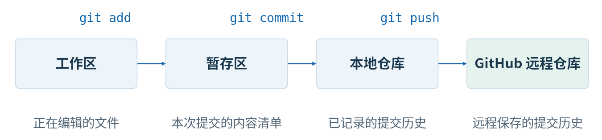
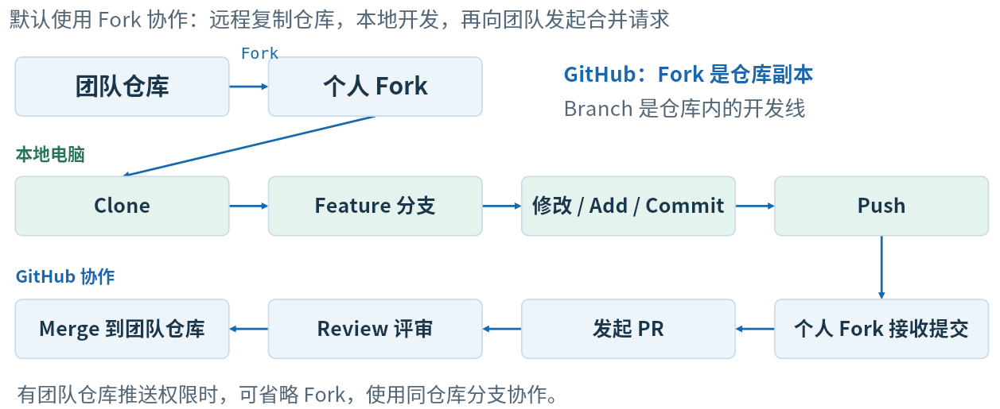
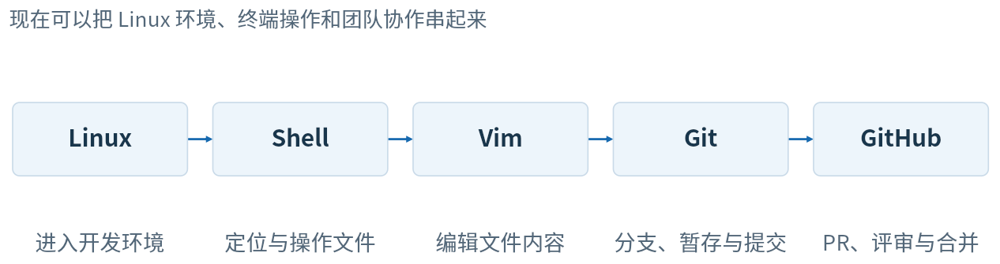

# 一、Linux基础

---

## 1、机器人开发中的Linux：

​	开发电脑 ——> ubantu Server ——> ROS节点/控制程序

## 2、Linux目录：

- Linux的目录从/开始，例：/home/user/example（绝对路径：从/开始）

- \~是当前用户的家目录，例：~/example（home目录中的 example）

- . 是当前目录，例：./hello.txt（相对路径：从当前位置开始）
---
 二、shell与命令
===
## 1、常规命令：

| 命令     | 作用 | 示例 |
| :-----: | :----: | :----: |
|`ls`|列出目录中的文件和子目录|   |
|`pwd`|显示当前目录||
|`cd`|进入指定目录，可用于下载时选定文件位置|`cd missing-semester`|
|`cd..`|返回上一级||
|`cd~`|返回家目录||
|`mkdir -p`|创建目录，允许补齐父目录|`mkdir -p ~/demo`|
|`touch`|创建空文件/更新时间|`touch train.txt`|
|cp|复制文件|`cp train.txt train-copy.txt`|
|`mv`|移动或重命名|`mv train-copy.txt backup.txt`|
|`rm`|删除文件（通常不进回收站）|`rm backup.txt`|
|`cat/les`|直接查看/分页查看|`cat train.txt`|

## 2、shell的常用组合：

| 变量 | `name="RM"` `echo "$name"` | 保存一个值，再通过变量引用它 （在shell关闭后，变量会被删除） |
| :----: | :-------------------------------: | :----------------------------: |
| 重定向 | `echo "hello" > hello.txt` | > 覆盖写入；>> 追加到文件末尾 |
|管道|`ls -la | grep txt`|将输出交给下一程序|
|条件连接|`mkdir -p demo && cd demo`|前一条成功后，在执行下一条|

## 3、使用命令小妙招：

- `ls --help`快速查看选项和用法
- `man ls`打开手册，按q退出
- `Tab`补全
- `↑ / ↓`调出历史命令
---
# 三、Vim

三种模式：（具体键位见本地的手册）[Vim快捷键速查](assets/VimGrammar.md)

- 普通模式：移动、删除、复制
- 插入模式：输入文本
- 命令行：保存、退出
---
# 四、Git与GitHub

## 1、Git常用命令：

| 命令 | 作用 |
| :----: | :----: |
| `git clone `<仓库地址> | 下载仓库及提交历史 |
| `git status` | 查看当前分支和文件状态 |
| `git diff` | 查看尚未暂存的修改 |
| `git log --oneline` | 用简短格式查看提交历史 |
| `git switch -c feature/hello` | 创建并切换到功能分支 |
| `git add hello.txt` | 暂存指定文件 |
| `git commit -m "Add greeting"` | 记录一次本地提交 |
| `git push -u origin feature/hello` | 推送并建立跟踪关系 |
| `git switch main` | 切回主分支 |
| `git pull` | 获取并整合当前分支的远程更新 |

## 2、团队开发注意事项：

==main 保持稳定，feature/hello 承载本次修改==

