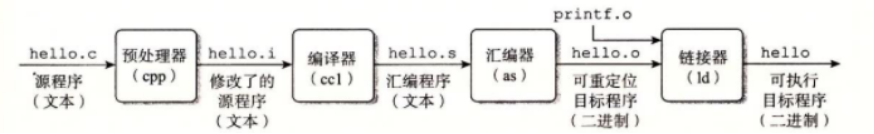
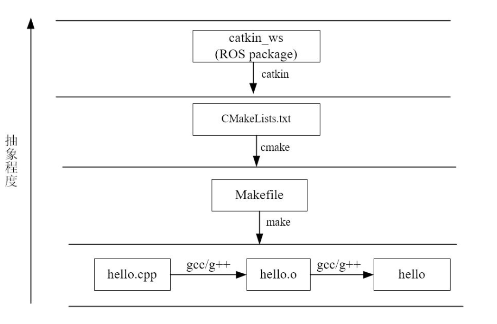

# 一、可执行程序的形成



## 1、gcc和g++编译：

- ```bash
  g++ -E main.cpp -o main.i	//预处理指令（展开所有的宏定义，处理欲编译指令，删除注释）
  ```

- ```bash
  g++ -S main.i -o main.s		//生成汇编程序
  ```

- ```bash
  g++ -c main.s -o main.o 	//得到目标程序（将指令打包成可重定位目标程序的格式）
  ```

- ```bash
  g++ main.o -o demo 			//链接得到可执行文件demo
  ```

### 补充概念：[虚拟内存](https://zhuanlan.zhihu.com/p/476697014)

​	虚拟内存又叫虚拟储存器

- 保护每个进程的地址空间不被其他进程破坏：它为每个内存提供了一个假象，每个进程都有独立的地址
- 简化了存储器的管理：它为每个进程提供独立的操作空间
- 高效利用主存：将主存看成在磁盘里面的高速缓存，在需要时在磁盘和主存之间来回传输数据

## 2、Makefile：

- 优点：可以自动完成编译，写好Makefile后，只需要执行make就可以编译

- 缺点：编写Makefile复杂

## 3、Cmake：

### [使用范例](assets/Cmake/)

### [更加完整的功能](https://www.runoob.com/cmake/cmake-basic.html)

- 定义：是一个可以生成Makefile的工具
- 优点：
  - 语法更加简洁易懂，使用更加方便
  - 跨平台性强：不管Linux还是Windows，都会生成对应的makefile或者project文件
  - 不管需要编译的源代码和头文件有多少，只需要管理好对应的目录，就可以实现自动编译，不需要手动添加文件

## 4、Catkin：

### 	1、定义：

​	Catkin是ROS的官方构建系统，是一个基于CMake的构建系统

​	[ Catkin的介绍 ](https://sychaichangkun.gitbooks.io/ros-tutorial-icourse163/content/chapter2/2.1.html)



### 	2、Catkin的完整使用流程：

> [ 资料参考  ROS官方 ](https://wiki.ros.org/catkin/Tutorials )

#### 		1. 进入容器：

​		[ROS容器使用标准](assets/ROS1.md)

#### 		2. 创建工作空间：

```bash
#创建文件夹
mkdir -p ~/catkin_ws/src
#进入根目录并编译（用于生成build 和 decel）
cd ~/catkin_ws
catkin_make
```

#### 		3. 创建功能包：

```bash
#注意：一定要进入src目录创建
cd ~/catkin_ws/src
#功能包语法：catkin_create_pkg 名字 依赖（可以有多个）
catkin_create_pkg my_first_cpp_pkg roscpp rospy
```

#### 		4. 编写C++代码：

```bash
#源码放在src文件夹
cd ~/catkin_ws/src/my_first_cpp_pkg
mkdir src
touch 名字.cpp
vim 名字.cpp（VSCode打开也行）
#接下来就可以创建C++并编写代码了
```

#### 		5. 配置CMakeLists.txt：

```bash
vim ~/catkin_ws/src/my_first_cpp_pkg/CMakeLists.txt
```

#### 		6. 编译工作空间：

```bash
cd ~/catkin_ws
catkin_make
```

#### 		7. 更新一下环境：

```bash
source ~/catkin_ws/devel/setup.bash
```

# 二、关于AI那些事

> [资料参照该链接](https://www.mihaileric.com/The-Emperor-Has-No-Clothes/)

## 1、前提概念：

- LLM：Large Language Model，翻译为大模型语言

## 2、AI运行逻辑：

==AI是一个大脑，发出指令下一步做什么；程序负责接受指令，并在电脑上完成==

使用AI实际上是执行一个循环代码，结构如下：

- **外层循环**：读取用户的输入
- **内层循环**：是否需要调用LLM
  - 不需要：返回响应并跳出循环
  - 需要：执行对应的工具程序，回到外层循环

上面的链接演示了如何创建一个迷你版的AI，并给出所需要的工具：

- **读取文件**，让 LLM 能看到你的代码
- **列出文件**，让它能浏览你的项目
- **编辑文件**，让它能给出创建和修改代码的指令

以Codex接入DeepSeek为例：

> ```markdown
> 你输入任务 
>    ↓
> DeepSeek判断要不要用工具
>    ↓
> 如果要：Codex的程序执行工具（读/写文件）
>    ↓
> 把执行结果再发给DeepSeek
>    ↓
> DeepSeek继续判断，直到任务完成
>    ↓
> DeepSeek给你最终答复，交由Codex输出给你看
> 
> ```

## 3、谈论我对AI的使用：

我刚开始接触这两个工具的时候我询问AI这两个工具是什么，但是当时的我根本看不懂这些官方的语言，于是我先到B站找视频了解这两个工具，在学习CMake有不懂的语法时，我发给AI问这句语法是什么意思，让他帮我拆解这句代码里面的具体每个参数的作用，帮助我从根本上学习，而不是只会复制粘贴

CMake的基础语法学习地差不多，我开始学习Catkin，但是这个工具要在ROS的基础下使用，所以我开始学习ROS的基础环境配置，询问AI关于ROS的用法，比如：如何正确配置好一个容器，创建功能包时要在哪个目录，为什么，功能包的具体作用等等细节问题，一步一步加深对ROS的理解。学到后面才知道，在配置ROS时就已经学习着Catkin了,下面是我跟AI的一段对话

> **最底层**：**Linux 操作系统**（地基，所有的软件都跑在它上面）。
>
> **编译底层**：**CMake 和 Make**（通用的 C/C++ 编译工具）。
>
> **构建系统**：**Catkin**（它在 CMake 外面包了一层，专门处理 ROS 的依赖和包的编译顺序）。
>
> **生态框架**：**ROS**（包含 Catkin，以及一大堆通信机制、工具、库）。

通过这些更加生动的比喻，我对每个工具的分工有了更深的认识

后面我用AI帮我搜集一些资料并带上链接，但有一些网站是英文的，而且浏览器的翻译出错率高，我就把网址发给AI，让他帮我翻译上面的内容，并附上一些他的看法，一步步学习

到了后面，我甚至做出了比较忍俊不禁的做法，我问AI我如何才能用好他，当然他也给出了回答

学习新事物是痛苦的，毕竟，上坡路最难的是起步，但又是令人兴奋的，每一次对他认识的加深，都会让我充满成就感，依附于强大的AI，我开始不畏惧新的事物，甚至开始对学习他们感到兴奋
